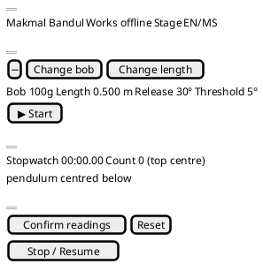
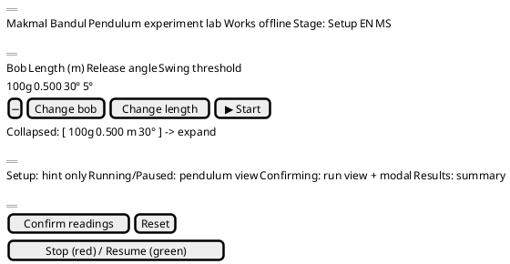
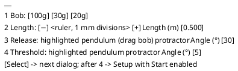
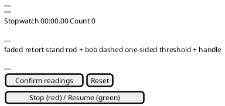
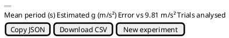

# Current Wireframe

> Historical snapshot of the pre-wireframe UI. `wireframe.md` is authoritative; the guided wizard, setup panel and pivot HUD described below have been replaced.

Snapshot of the implemented UI (`src/main.rs`, `src/components/`, `style.css`). Desktop (≥900px) places Setup beside the phase screen; mobile stacks them in the same order. The guided wizard is a bottom sheet below 700px and a centered modal above it.

## Mobile Behaviour

- Below 900px the workspace is one column: the setup panel is a normal inline card above the phase screen, not a sticky sidebar.
- Below 700px modals are bottom sheets — full width, rounded top corners, up to 92vh with internal scrolling; above 700px they are centred with padding.
- The topbar wraps on narrow screens. Primary buttons are 50–56px tall, the language select 44px, and the compact setup-menu buttons 38px; the tap highlight is disabled.
- Ruler, protractor and pendulum SVGs use `touch-action: none` with pointer capture so dragging does not scroll the page; keyboard arrows and Home/End (plus PageUp/PageDown on ruler/protractor) also change values.
- Bob cards and result summary cards reflow to the available width; the readings table scrolls horizontally inside its modal.
- `prefers-reduced-motion` removes the Start/Stop pulse and pendulum glow.

## Persistent Page

`Start` lives in the setup panel; the bottom action bar appears only once a run exists.

## First-Load Setup Wizard

Editing bob or length while running pauses the run and reopens this wizard; `Select` returns to Setup for a fresh Start.

## Running / Paused

Paused freezes physics and the stopwatch; `Confirming` keeps this view under the readings modal. Numeric readouts use tool precision (length 3 decimals, angles and time 2/0 decimals as applicable).

## Confirming

```plantuml
@startsalt
{
  {== Modal overlay over the paused run view ==}
  { Trial | Bob | Length (m) | Release (°) | Time (s) | Swings }
  { 1 | 100g | 0.500 | 30 | 10.00 | 20 }
  { [Back] | [Add reading] | [Save & continue] }
}
@endsalt
```

## Results

`New experiment` clears the run and readings, reopens the wizard at Bob, and returns to Setup.
